<div align="center">


# procedural-machine-audio

[English](README.md) · [繁體中文](README.zh-TW.md) · **日本語** · [Tiếng Việt](README.vi.md)

**インタラクティブな機械とシミュレーションのためのプロシージャル・オーディオエンジン。**

クリック音、やわらかなエア音、空気圧のこもった音、すばやく動くアームの気流音 —— すべて Web Audio API でリアルタイム合成。音声ファイルは使いません。

**[▶ ライブデモ](https://pma.rewrite.tw/?lang=ja)** · ヘッドホン推奨

<a href="https://pma.rewrite.tw/?lang=ja"></a> <a href="LICENSE"></a>  

</div>

---

##  できること

<table>
<tr><td><b>イベント → 音</b></td><td>シミュレーションのイベントを音のレシピに割り当て、<code>emit()</code> するだけ。</td></tr>
<tr><td><b>動き → 気流</b></td><td>動く部品の速度を毎フレーム渡すと、気流音がふくらみ、明るくなり、押し出されます。</td></tr>
<tr><td><b>長時間聴くために</b></td><td>共振しない広帯域フィルタ、メロディなし、連打の統合、出力リミッター。何時間でも心地よく。</td></tr>
<tr><td><b>小さい</b></td><td>実行時の依存パッケージはゼロ。TypeScript で型定義も完備。</td></tr>
</table>

このエンジンは <a href="https://qm4.rewrite.tw/?lang=ja">QM-4 · 機械の音</a> から切り出したものです。「聴く」ために作られた架空のマウンターの 3D シミュレーターです。ここのデモはあえて最小限にしてあり、完全な作品はそのサイトで体験できます。

## 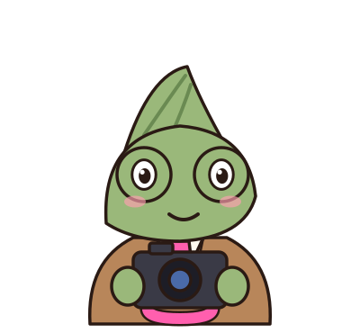 見てみる

<p align="center"><a href="https://pma.rewrite.tw/?lang=ja">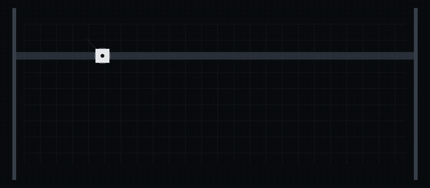</a></p>

<p align="center">GIF には音がありません。音を聴くなら：<a href="https://pma.rewrite.tw/?lang=ja">ライブデモ</a> · <a href="docs/media/demo.mp4">音つき 12 秒クリップ（MP4）</a>。</p>

## 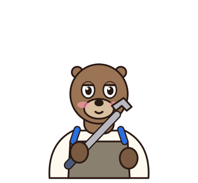 インストール

npm にはまだ公開していません。GitHub から直接インストールできます（インストール時に自動でビルドされます）：

```bash
npm install github:TENMALOG/procedural-machine-audio
```

##  クイックスタート

```ts
import { MachineAudio } from 'procedural-machine-audio';

const audio = new MachineAudio();

// 1. 音はユーザー操作のあとでしか鳴らせません
startButton.onclick = () => audio.start();

// 2. シミュレーションのイベントを内蔵（または自作）のレシピに割り当てる
audio.bind('PART_PLACED', { recipe: 'click', gain: 0.9 });
audio.bind('VACUUM_ON', 'hiss');

simulation.on('PART_PLACED', (e) => audio.emit('PART_PLACED', { pan: e.x }));

// 3. 動く部品の気流音を毎フレーム更新する
function frame() {
  const speed01 = head.speed / head.maxSpeed; // 0 = 静止、1 = 全速
  if (audio.ready) audio.airflow('head').update(speed01, 1);
  requestAnimationFrame(frame);
}
```

##  API

### `new MachineAudio(options?)`

| オプション | 既定値 |  |
|---|---|---|
| `context` | — | 既存の <code>AudioContext</code>／<code>OfflineAudioContext</code> を使う。なければ <code>start()</code> が作成します。 |
| `latency` | `0.03` | 発音ごとに加える秒数。描画ループから予約した音が遅れて鳴らないようにします。 |
| `maxVoices` | `48` | 同時に鳴らせるワンショットの上限。 |
| `reverb` | `0.12` | 空間の量、0–1。 |

| メソッド | |
|---|---|
| <code>start()</code> | audio context を作成／再開します。クリックやタップのハンドラ内で呼んでください。iPhone のサイレントスイッチがオンでも音が出るようにします。 |
| <code>play(name, { when?, delay?, gain?, pan?, key?, category? })</code> | レシピを再生します。スキップされた場合（未知、無音、数ミリ秒前の同じ発音と統合）は <code>false</code>。 |
| <code>bind(event, recipe &#124; { recipe, gain?, category? })</code>／<code>emit(event, options?)</code> | シミュレーションのイベントをレシピに割り当てます。 |
| <code>define(name, recipe)</code> | 独自のレシピを追加します。 |
| <code>airflow(id, { style?, pan? })</code> | 名前付きの気流ボイスを取得／作成します。毎フレーム <code>.update(speed01, level)</code>、<code>.setStyle()</code> で音色変更、<code>.silence()</code> で停止。 |
| <code>setLevel('master' &#124; 'events' &#124; 'airflow', value)</code>、<code>setReverb(amount)</code> | ミックス。 |
| <code>output</code> | 最終ノード（リミッターの後）。アナライザーや <code>MediaRecorder</code> に接続できます。 |
| <code>suspend()</code>／<code>resume()</code>／<code>stopAll()</code>／<code>dispose()</code> | ライフサイクル。 |

### 内蔵レシピ

`click` · `tap` · `lift` · `hiss` · `leak` · `puff` · `feed` · `clamp` · `unclamp` · `shutter` · `swap` · `settle`

### 気流の音色

<code>smooth</code>（既定）· <code>warm</code>（暗め・やわらか）· <code>airy</code>（軽め）· <code>slow</code>（ゆっくりしたうねり）

##  独自のレシピを書く

レシピはただのデータで、レイヤーの並びです。各レイヤーはバンドパスしたノイズか短いトーンで、それぞれにエンベロープがあります。

```ts
audio.define('latch', [
  { kind: 'noise', noise: 'pink', freq: 1400, q: 0.8, lowpass: 3500, gain: 0.5, attack: 0.004, decay: 0.04 },
  { kind: 'noise', noise: 'brown', freq: 220, q: 0.7, lowpass: 600, gain: 0.25, attack: 0.008, decay: 0.12, delay: 0.03 },
]);
audio.play('latch');
```

心地よい音を保つコツ：<code>q</code> は低め（約 0.6–1.5）にし、<code>lowpass</code> を加え、ノイズレイヤーには数ミリ秒の <code>attack</code> を与え、長いトーンのレイヤーは避けること。

## 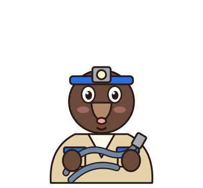 低レベルの部品

エンジンが使う部品はすべてエクスポートされているので、独自の構成も組めます：

| エクスポート | |
|---|---|
| <code>renderRecipe(ctx, destination, noise, recipe, { when, gain })</code> | レシピを任意のノードに予約します。 |
| <code>AirflowVoice</code>、<code>getAirflowBuffers</code>、<code>AIRFLOW_STYLES</code> | 気流シンセサイザーと、FFT で整形したループバッファ。 |
| <code>createNoiseBank(ctx, seconds, seed)</code> | シード指定可能で、継ぎ目なくループするホワイト／ピンク／ブラウンノイズ。 |
| <code>createRoomImpulse(ctx)</code> | <code>ConvolverNode</code> 用の短くやわらかな空間インパルス応答。 |
| <code>VoicePool</code> | ボイス数の上限、古いボイスの奪取、連続イベントの統合。 |
| <code>EventScheduler</code> | シミュレーション用の決定的なイベントキュー（時刻、次に追加順）。 |
| <code>planMove</code>、<code>sampleMove</code> | 台形／S 字カーブの移動プロファイル。もっともらしい速度で気流を動かせます。 |

##  気流音のしくみ

2 層のループノイズを逆 FFT で一度だけ作るので、継ぎ目なくループします：

- <b>ボディ</b>：広い周波数カーブを持つノイズ。音量は速度の 2 乗に従い、その下に小さな常時の気流があり、スペクトル全体も速度とともに上へ移動します。
- <b>プッシュ</b>：ガウス形の低域ノイズ帯（共振ではありません）で、中心周波数が速度とともに上がります。ボディより速いエンベロープなので、動き出すたびにやわらかな「押し」が入ります。

高域のシェルフはボディより少し遅れて開き（「空気感」）、音像は左右にゆるやかに揺れます。オシレーターも共振フィルタも使わないので、うなりや笛のような音は出ません。

##  開発

```bash
npm install
npm run dev        # http://localhost:5320 でデモを開く
npm test           # ユニットテスト
npm run build      # ライブラリ → dist/
npm run build:demo # 静的デモ → dist-demo/
```

Node.js 20 以上が必要です。

## 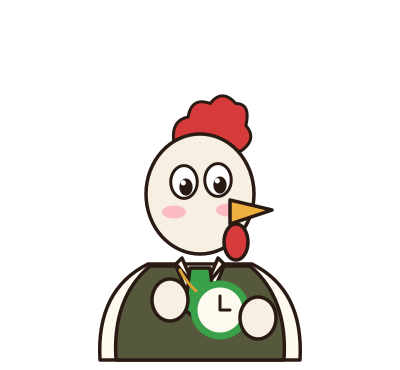 ステータス

<code>0.1.0</code>：初期段階で、API は今後変わる可能性があります。

##  ライセンス

コード：[MIT](LICENSE) © 2026 TENMALOG。

<code>docs/cast/</code> のキャラクターイラストは TENMALOG による假想社のオリジナルキャラクターで、MIT ライセンスの対象<b>外</b>です。すべての権利を留保します（[詳細](docs/cast/NOTICE.md)）。QM-4 のサイト本体、3D モデル、アートワーク、調整済みのサウンドも別の作品であり、含まれません。

---

<div align="center">

### 假想社のメンバー


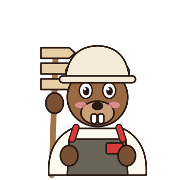
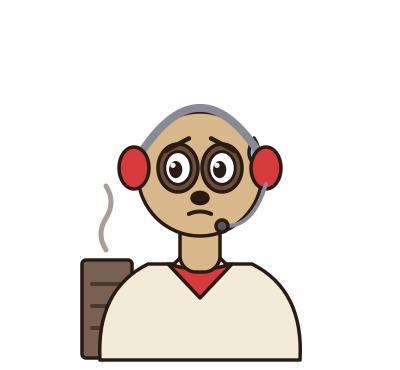
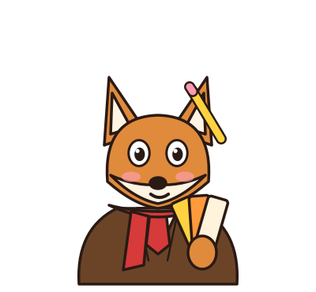

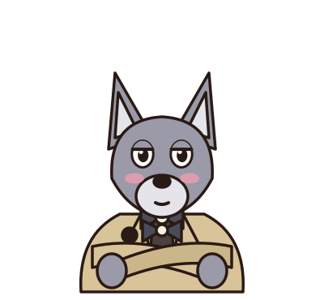


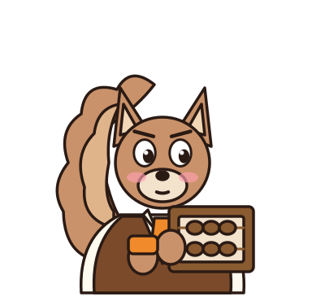


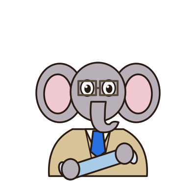


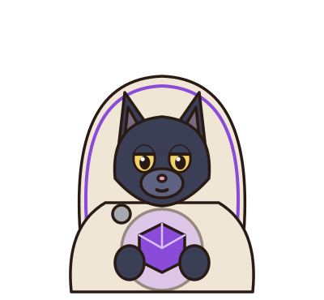
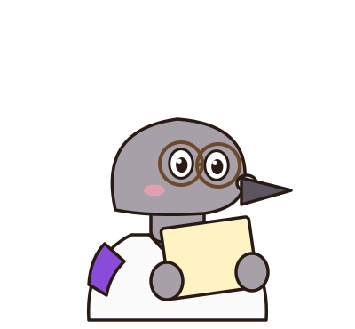


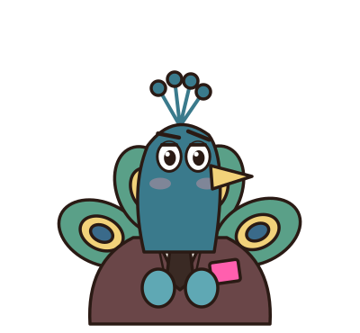
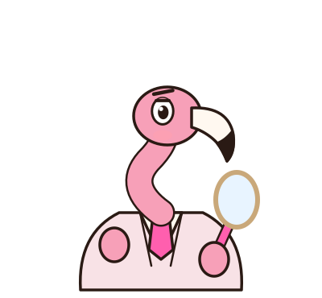


<sub>TENMALOG のオリジナルキャラクターたちが、この README にお付き合いします。</sub>

<br><br>

制作：<b>TENMALOG</b> · <a href="https://qm4.rewrite.tw/?lang=ja">QM-4</a> · <a href="https://pma.rewrite.tw/?lang=ja">ライブデモ</a>

</div>
