<div align="center">

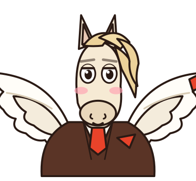

# procedural-machine-audio

**English** · [繁體中文](README.zh-TW.md) · [日本語](README.ja.md) · [Tiếng Việt](README.vi.md)

**A procedural audio engine for interactive machines and simulations.**

Clicks, soft hisses, pneumatic thuds and the airflow of a fast-moving arm — synthesized live with the Web Audio API. No audio files.

**[▶ Live demo](https://pma.rewrite.tw/)** · headphones recommended

<a href="https://pma.rewrite.tw/"></a> <a href="LICENSE"></a>  

</div>

---

## 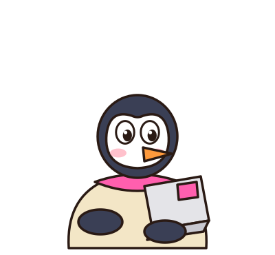 What it does

<table>
<tr><td><b>Event → sound</b></td><td>Map your simulation's events to sound recipes, then <code>emit()</code> them.</td></tr>
<tr><td><b>Motion → airflow</b></td><td>Feed the speed of a moving part every frame; the airflow swells, brightens and pushes with it.</td></tr>
<tr><td><b>Built for long listening</b></td><td>Broad, non-ringing filters, no melodies, burst merging and an output limiter — pleasant for hours.</td></tr>
<tr><td><b>Tiny</b></td><td>Zero runtime dependencies. TypeScript with full types.</td></tr>
</table>

This engine was extracted from <a href="https://qm4.rewrite.tw/">QM-4 · The sound of a machine</a>, a 3D simulator of a fictional pick-and-place machine made for listening. The demo here is deliberately minimal; the full experience lives on that site.

## 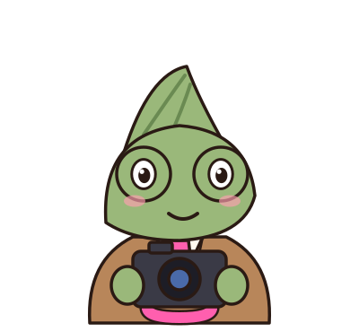 See it

<p align="center"><a href="https://pma.rewrite.tw/">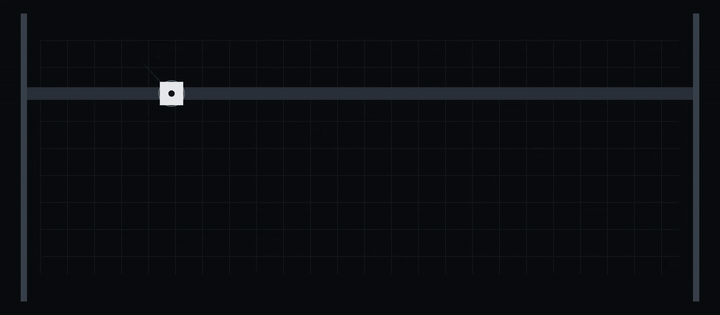</a></p>

<p align="center">The GIF is silent. Hear it: <a href="https://pma.rewrite.tw/">live demo</a> · <a href="docs/media/demo.mp4">12-second clip with sound (MP4)</a>.</p>

## 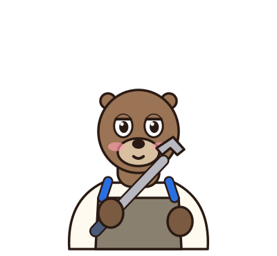 Install

Not on npm yet — install straight from GitHub (it builds itself on install):

```bash
npm install github:TENMALOG/procedural-machine-audio
```

## 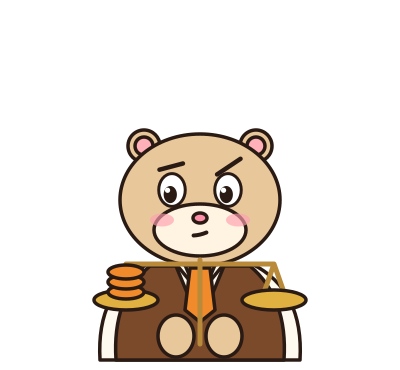 Quick start

```ts
import { MachineAudio } from 'procedural-machine-audio';

const audio = new MachineAudio();

// 1. Audio can only start after a user gesture
startButton.onclick = () => audio.start();

// 2. Map your simulation's events to built-in (or your own) recipes
audio.bind('PART_PLACED', { recipe: 'click', gain: 0.9 });
audio.bind('VACUUM_ON', 'hiss');

simulation.on('PART_PLACED', (e) => audio.emit('PART_PLACED', { pan: e.x }));

// 3. Drive the airflow of a moving part every frame
function frame() {
  const speed01 = head.speed / head.maxSpeed; // 0 = still, 1 = full speed
  if (audio.ready) audio.airflow('head').update(speed01, 1);
  requestAnimationFrame(frame);
}
```

## 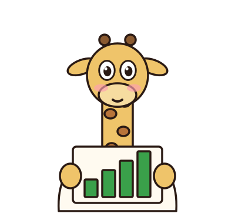 API

### `new MachineAudio(options?)`

| option | default |  |
|---|---|---|
| `context` | — | Use an existing <code>AudioContext</code> / <code>OfflineAudioContext</code>. Otherwise <code>start()</code> creates one. |
| `latency` | `0.03` | Seconds added to "now" for every trigger, so sounds scheduled from a render loop never start late. |
| `maxVoices` | `48` | Maximum simultaneous one-shots. |
| `reverb` | `0.12` | Room amount, 0–1. |

| method | |
|---|---|
| <code>start()</code> | Create / resume the audio context. Call it inside a click or tap handler. Also lets sound play with the iPhone silent switch on. |
| <code>play(name, { when?, delay?, gain?, pan?, key?, category? })</code> | Play a recipe. Returns <code>false</code> if skipped (unknown, silent, or merged with an identical trigger a few ms earlier). |
| <code>bind(event, recipe &#124; { recipe, gain?, category? })</code> / <code>emit(event, options?)</code> | Map simulation events to recipes. |
| <code>define(name, recipe)</code> | Add your own recipe. |
| <code>airflow(id, { style?, pan? })</code> | Get or create a named airflow voice. Call <code>.update(speed01, level)</code> every frame, <code>.setStyle()</code> to change it, <code>.silence()</code> to stop. |
| <code>setLevel('master' &#124; 'events' &#124; 'airflow', value)</code>, <code>setReverb(amount)</code> | Mixing. |
| <code>output</code> | The final node (after the limiter) for analysers or <code>MediaRecorder</code>. |
| <code>suspend()</code> / <code>resume()</code> / <code>stopAll()</code> / <code>dispose()</code> | Lifecycle. |

### Built-in recipes

`click` · `tap` · `lift` · `hiss` · `leak` · `puff` · `feed` · `clamp` · `unclamp` · `shutter` · `swap` · `settle`

### Airflow styles

<code>smooth</code> (default) · <code>warm</code> (darker, softer) · <code>airy</code> (lighter) · <code>slow</code> (slow swells)

##  Writing your own recipe

A recipe is plain data: a list of layers. Each layer is band-passed noise or a short tone with its own envelope.

```ts
audio.define('latch', [
  { kind: 'noise', noise: 'pink', freq: 1400, q: 0.8, lowpass: 3500, gain: 0.5, attack: 0.004, decay: 0.04 },
  { kind: 'noise', noise: 'brown', freq: 220, q: 0.7, lowpass: 600, gain: 0.25, attack: 0.008, decay: 0.12, delay: 0.03 },
]);
audio.play('latch');
```

Tips for sounds that stay pleasant: keep <code>q</code> low (≈0.6–1.5), add a <code>lowpass</code>, give noise layers a few milliseconds of <code>attack</code>, and avoid long tonal layers.

## 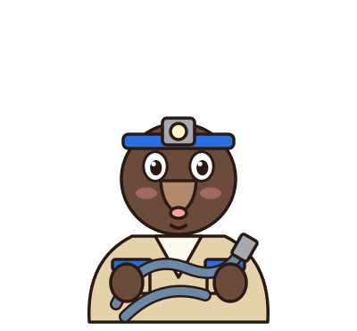 Building blocks

Everything the engine uses is exported, so you can build your own graph:

| export | |
|---|---|
| <code>renderRecipe(ctx, destination, noise, recipe, { when, gain })</code> | Schedule a recipe into any node. |
| <code>AirflowVoice</code>, <code>getAirflowBuffers</code>, <code>AIRFLOW_STYLES</code> | The airflow synthesizer and its FFT-shaped loop buffers. |
| <code>createNoiseBank(ctx, seconds, seed)</code> | Seeded, seamlessly looping white / pink / brown noise. |
| <code>createRoomImpulse(ctx)</code> | A short soft room impulse response for a <code>ConvolverNode</code>. |
| <code>VoicePool</code> | Voice cap, oldest-voice stealing and burst merging. |
| <code>EventScheduler</code> | Deterministic (time, insertion-order) event queue for simulations. |
| <code>planMove</code>, <code>sampleMove</code> | Trapezoid / S-curve move profiles, to drive airflow with plausible speed. |

##  How the airflow works

Two looping noise layers are built once with an inverse FFT, so they loop seamlessly:

- <b>body</b> — noise with a broad spectral curve; its level follows speed² over a quiet constant bed, and the whole spectrum glides up with speed.
- <b>push</b> — a Gaussian band of low noise (not a resonance) whose centre rises with speed. Its envelope is faster than the body's, so every move begins with a soft push.

A high shelf opens slightly later than the body ("air"), and the image drifts gently in stereo. No oscillators and no resonant filters are involved, so nothing rings or whistles.

##  Develop

```bash
npm install
npm run dev        # opens the demo at http://localhost:5320
npm test           # unit tests
npm run build      # library → dist/
npm run build:demo # static demo → dist-demo/
```

Requires Node.js 20 or newer.

## 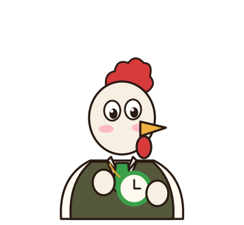 Status

<code>0.1.0</code> — early. The API may still change.

## 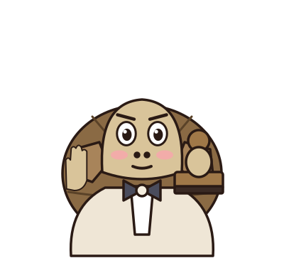 License

Code: [MIT](LICENSE) © 2026 TENMALOG.

The character illustrations in <code>docs/cast/</code> are original characters of 假想社 by TENMALOG and are <b>not</b> covered by the MIT License — all rights reserved ([details](docs/cast/NOTICE.md)). The QM-4 website, its 3D models, artwork and tuned sounds are separate works and not included.

---

<div align="center">

### The 假想社 cast


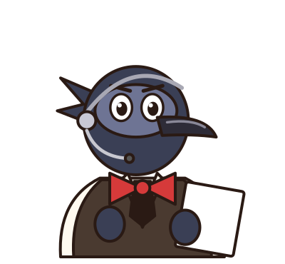

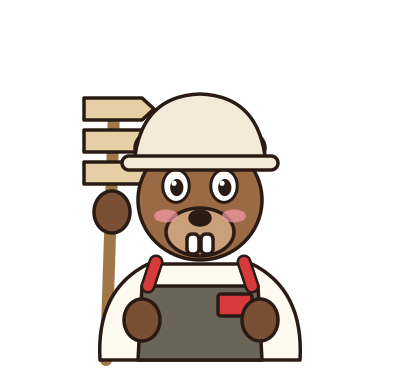
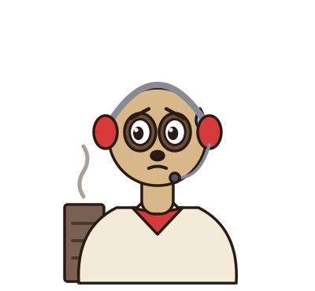
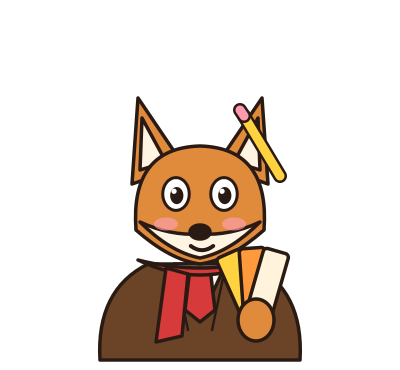

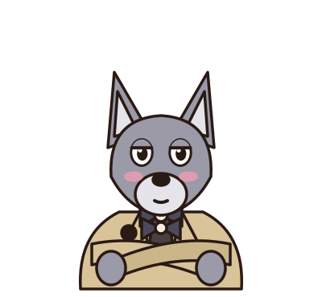


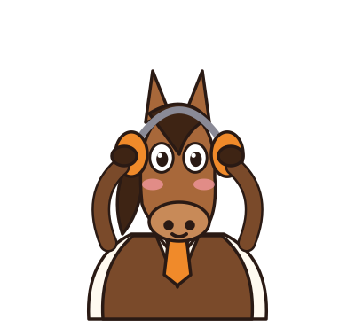
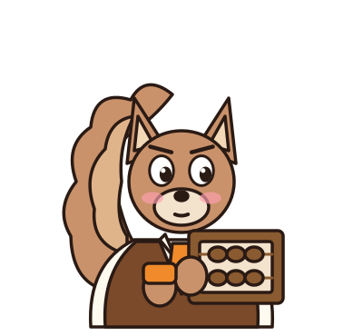
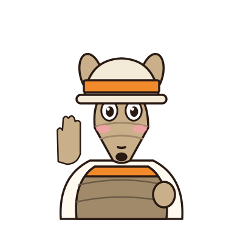

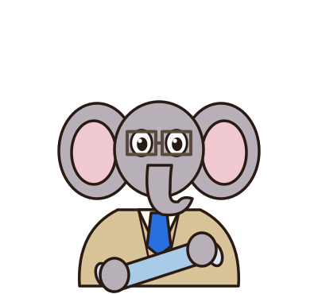


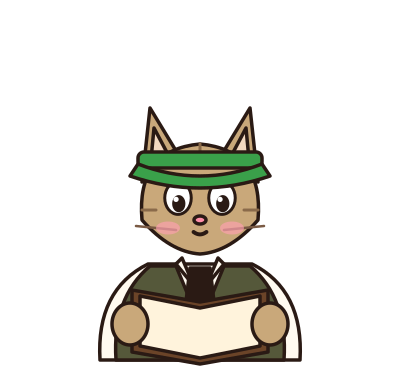

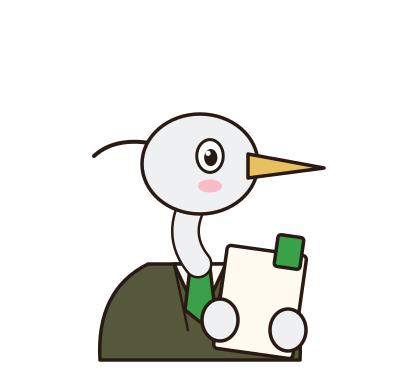

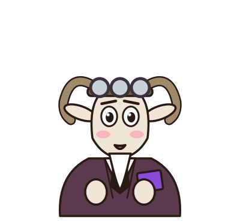
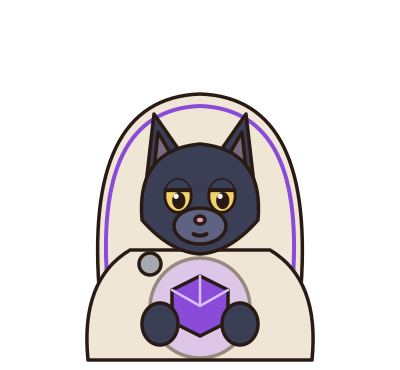
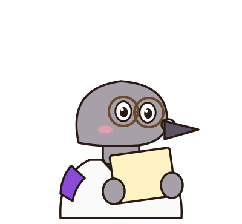

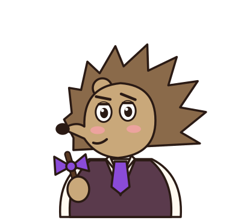
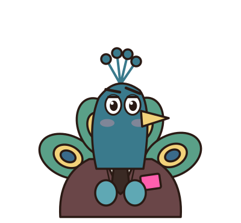
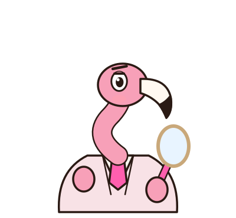

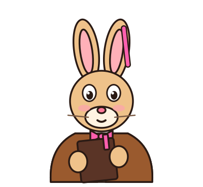


<sub>Original characters by TENMALOG — they keep this README company.</sub>

<br><br>

Made by <b>TENMALOG</b> · <a href="https://qm4.rewrite.tw/">QM-4</a> · <a href="https://pma.rewrite.tw/">Live demo</a>

</div>
