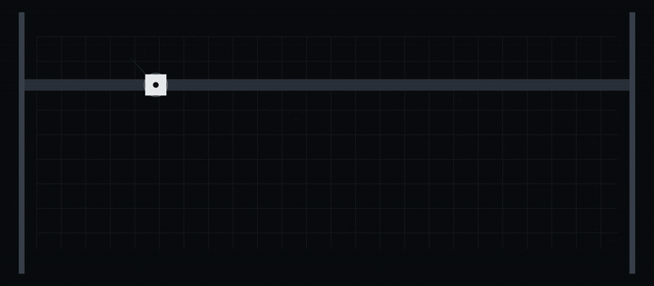
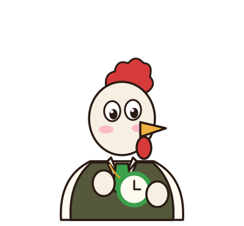
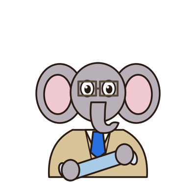
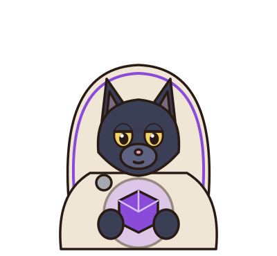
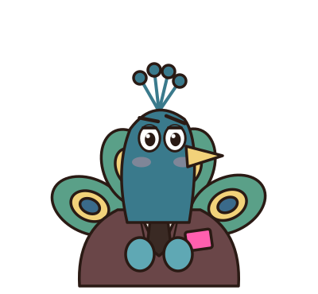
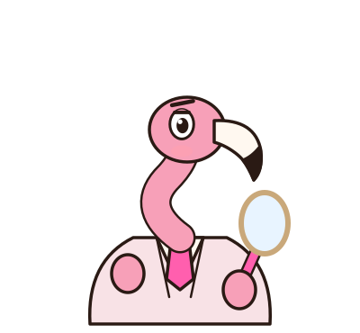

<div align="center">


# procedural-machine-audio

[English](README.md) · [繁體中文](README.zh-TW.md) · [日本語](README.ja.md) · **Tiếng Việt**

**Engine âm thanh thủ tục cho máy móc tương tác và mô phỏng.**

Tiếng tách, tiếng xì nhẹ, tiếng khí nén trầm và luồng khí của một cánh tay di chuyển nhanh — tổng hợp trực tiếp bằng Web Audio API. Không có tệp âm thanh nào.

**[▶ Demo trực tuyến](https://pma.rewrite.tw/?lang=vi)** · nên dùng tai nghe

<a href="https://pma.rewrite.tw/?lang=vi"></a> <a href="LICENSE"></a>  

</div>

---

##  Nó làm được gì

<table>
<tr><td><b>Sự kiện → âm thanh</b></td><td>Gán các sự kiện của mô phỏng cho công thức âm thanh, rồi gọi <code>emit()</code>.</td></tr>
<tr><td><b>Chuyển động → luồng khí</b></td><td>Truyền tốc độ của bộ phận đang chuyển động mỗi khung hình; luồng khí phồng lên, sáng hơn và đẩy tới theo nó.</td></tr>
<tr><td><b>Làm cho việc nghe lâu</b></td><td>Bộ lọc băng rộng không cộng hưởng, không giai điệu, gộp các loạt sự kiện và bộ giới hạn ở đầu ra — nghe hàng giờ vẫn dễ chịu.</td></tr>
<tr><td><b>Nhỏ gọn</b></td><td>Không có phụ thuộc lúc chạy. TypeScript với kiểu đầy đủ.</td></tr>
</table>

Engine này được tách ra từ <a href="https://qm4.rewrite.tw/?lang=vi">QM-4 · Âm thanh của một cỗ máy</a>, một trình mô phỏng 3D về một máy gắn linh kiện hư cấu được làm ra để nghe. Bản demo ở đây được cố tình làm tối giản; trải nghiệm đầy đủ nằm trên trang web đó.

##  Xem thử

<p align="center"><a href="https://pma.rewrite.tw/?lang=vi"></a></p>

<p align="center">GIF không có tiếng. Để nghe: <a href="https://pma.rewrite.tw/?lang=vi">demo trực tuyến</a> · <a href="docs/media/demo.mp4">đoạn 12 giây có tiếng (MP4)</a>.</p>

##  Cài đặt

Chưa có trên npm — cài trực tiếp từ GitHub (tự động build khi cài):

```bash
npm install github:TENMALOG/procedural-machine-audio
```

##  Bắt đầu nhanh

```ts
import { MachineAudio } from 'procedural-machine-audio';

const audio = new MachineAudio();

// 1. Âm thanh chỉ có thể bắt đầu sau một thao tác của người dùng
startButton.onclick = () => audio.start();

// 2. Gán các sự kiện của mô phỏng cho công thức có sẵn (hoặc của bạn)
audio.bind('PART_PLACED', { recipe: 'click', gain: 0.9 });
audio.bind('VACUUM_ON', 'hiss');

simulation.on('PART_PLACED', (e) => audio.emit('PART_PLACED', { pan: e.x }));

// 3. Điều khiển luồng khí của bộ phận chuyển động mỗi khung hình
function frame() {
  const speed01 = head.speed / head.maxSpeed; // 0 = đứng yên, 1 = tốc độ tối đa
  if (audio.ready) audio.airflow('head').update(speed01, 1);
  requestAnimationFrame(frame);
}
```

##  API

### `new MachineAudio(options?)`

| tùy chọn | mặc định |  |
|---|---|---|
| `context` | — | Dùng một <code>AudioContext</code> / <code>OfflineAudioContext</code> có sẵn. Nếu không, <code>start()</code> sẽ tạo mới. |
| `latency` | `0.03` | Số giây cộng thêm vào "hiện tại" cho mỗi lần phát, để âm thanh lên lịch từ vòng lặp vẽ không bị trễ. |
| `maxVoices` | `48` | Số âm thanh ngắn phát cùng lúc tối đa. |
| `reverb` | `0.12` | Lượng không gian, 0–1. |

| phương thức | |
|---|---|
| <code>start()</code> | Tạo / tiếp tục audio context. Hãy gọi trong trình xử lý nhấp chuột hoặc chạm. Cũng giúp có tiếng khi iPhone bật công tắc im lặng. |
| <code>play(name, { when?, delay?, gain?, pan?, key?, category? })</code> | Phát một công thức. Trả về <code>false</code> nếu bị bỏ qua (không rõ, im lặng, hoặc gộp với một lần phát giống hệt vài mili giây trước). |
| <code>bind(event, recipe &#124; { recipe, gain?, category? })</code> / <code>emit(event, options?)</code> | Gán sự kiện của mô phỏng cho công thức. |
| <code>define(name, recipe)</code> | Thêm công thức của riêng bạn. |
| <code>airflow(id, { style?, pan? })</code> | Lấy hoặc tạo một giọng luồng khí có tên. Gọi <code>.update(speed01, level)</code> mỗi khung hình, <code>.setStyle()</code> để đổi âm sắc, <code>.silence()</code> để dừng. |
| <code>setLevel('master' &#124; 'events' &#124; 'airflow', value)</code>, <code>setReverb(amount)</code> | Trộn âm. |
| <code>output</code> | Nút cuối cùng (sau bộ giới hạn), để nối bộ phân tích hoặc <code>MediaRecorder</code>. |
| <code>suspend()</code> / <code>resume()</code> / <code>stopAll()</code> / <code>dispose()</code> | Vòng đời. |

### Công thức có sẵn

`click` · `tap` · `lift` · `hiss` · `leak` · `puff` · `feed` · `clamp` · `unclamp` · `shutter` · `swap` · `settle`

### Âm sắc luồng khí

<code>smooth</code> (mặc định) · <code>warm</code> (trầm, mềm hơn) · <code>airy</code> (nhẹ hơn) · <code>slow</code> (dâng lên chậm rãi)

##  Viết công thức của riêng bạn

Một công thức chỉ là dữ liệu: một danh sách các lớp. Mỗi lớp là nhiễu qua bộ lọc thông dải hoặc một âm ngắn, mỗi lớp có đường bao riêng.

```ts
audio.define('latch', [
  { kind: 'noise', noise: 'pink', freq: 1400, q: 0.8, lowpass: 3500, gain: 0.5, attack: 0.004, decay: 0.04 },
  { kind: 'noise', noise: 'brown', freq: 220, q: 0.7, lowpass: 600, gain: 0.25, attack: 0.008, decay: 0.12, delay: 0.03 },
]);
audio.play('latch');
```

Mẹo để âm thanh luôn dễ chịu: giữ <code>q</code> thấp (khoảng 0,6–1,5), thêm <code>lowpass</code>, cho các lớp nhiễu vài mili giây <code>attack</code>, và tránh các lớp âm điệu dài.

##  Các khối cấp thấp

Mọi thành phần engine sử dụng đều được xuất ra, nên bạn có thể tự dựng chuỗi xử lý:

| xuất | |
|---|---|
| <code>renderRecipe(ctx, destination, noise, recipe, { when, gain })</code> | Lên lịch một công thức vào bất kỳ nút nào. |
| <code>AirflowVoice</code>, <code>getAirflowBuffers</code>, <code>AIRFLOW_STYLES</code> | Bộ tổng hợp luồng khí và các bộ đệm lặp được tạo hình bằng FFT. |
| <code>createNoiseBank(ctx, seconds, seed)</code> | Nhiễu trắng / hồng / nâu có hạt giống, lặp liền mạch. |
| <code>createRoomImpulse(ctx)</code> | Đáp ứng xung phòng ngắn và mềm cho <code>ConvolverNode</code>. |
| <code>VoicePool</code> | Giới hạn số giọng, chiếm giọng cũ nhất, gộp các loạt sự kiện. |
| <code>EventScheduler</code> | Hàng đợi sự kiện tất định cho mô phỏng (theo thời gian, rồi theo thứ tự thêm vào). |
| <code>planMove</code>, <code>sampleMove</code> | Biên dạng chuyển động hình thang / đường cong S, để luồng khí theo tốc độ hợp lý. |

##  Cách luồng khí hoạt động

Hai lớp nhiễu lặp được dựng một lần bằng FFT ngược, nên lặp liền mạch:

- <b>thân</b> — nhiễu có đường cong phổ rộng; âm lượng theo bình phương tốc độ, bên dưới có một luồng khí nền nhỏ cố định, và toàn bộ phổ dịch lên theo tốc độ.
- <b>đẩy</b> — một dải nhiễu trầm hình Gauss (không phải cộng hưởng) có tần số trung tâm tăng theo tốc độ. Đường bao nhanh hơn phần thân, nên mỗi chuyển động bắt đầu bằng một cú "đẩy" nhẹ.

Bộ lọc kệ cao mở muộn hơn phần thân một chút ("cảm giác không khí"), và hình ảnh âm thanh trôi nhẹ giữa trái và phải. Không có bộ dao động hay bộ lọc cộng hưởng, nên không có tiếng ù hay tiếng huýt.

##  Phát triển

```bash
npm install
npm run dev        # mở demo tại http://localhost:5320
npm test           # kiểm thử đơn vị
npm run build      # thư viện → dist/
npm run build:demo # demo tĩnh → dist-demo/
```

Cần Node.js 20 trở lên.

##  Trạng thái

<code>0.1.0</code> — giai đoạn đầu. API vẫn có thể thay đổi.

##  Giấy phép

Mã nguồn: [MIT](LICENSE) © 2026 TENMALOG.

Các hình nhân vật trong <code>docs/cast/</code> là nhân vật gốc của 假想社 do TENMALOG sáng tạo và <b>không</b> thuộc phạm vi giấy phép MIT — mọi quyền được bảo lưu ([chi tiết](docs/cast/NOTICE.md)). Trang web QM-4, các mô hình 3D, hình ảnh và âm thanh đã tinh chỉnh của nó cũng là những tác phẩm riêng và không được bao gồm.

---

<div align="center">

### Các thành viên 假想社












<sub>Nhân vật gốc của TENMALOG — đồng hành cùng bạn trong README này.</sub>

<br><br>

Thực hiện: <b>TENMALOG</b> · <a href="https://qm4.rewrite.tw/?lang=vi">QM-4</a> · <a href="https://pma.rewrite.tw/?lang=vi">Demo trực tuyến</a>

</div>
