<div align="center">


# procedural-machine-audio

[English](README.md) · **繁體中文** · [日本語](README.ja.md) · [Tiếng Việt](README.vi.md)

**給互動機械與模擬用的程序式音效引擎。**

喀聲、輕柔的嘶聲、氣壓的悶響、快速移動手臂帶起的氣流聲 —— 全部用 Web Audio API 即時合成，沒有任何音檔。

**[▶ 線上示範](https://pma.rewrite.tw/?lang=zh)** · 建議戴上耳機

<a href="https://pma.rewrite.tw/?lang=zh"></a> <a href="LICENSE"></a>  

</div>

---

## 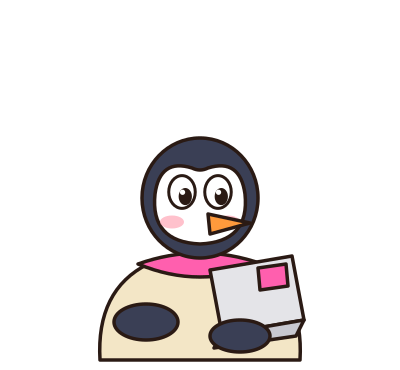 它能做什麼

<table>
<tr><td><b>事件 → 聲音</b></td><td>把模擬的事件對應到聲音配方，然後 <code>emit()</code>。</td></tr>
<tr><td><b>動作 → 氣流</b></td><td>每一幀傳入移動部件的速度，氣流聲會跟著鼓起、變亮、往前推。</td></tr>
<tr><td><b>為長時間聆聽而做</b></td><td>寬頻、不共振的濾波器，沒有旋律；連發事件會合併，輸出端有限幅器。聽幾個小時也不刺耳。</td></tr>
<tr><td><b>很小</b></td><td>沒有任何執行期相依套件。TypeScript 撰寫，型別完整。</td></tr>
</table>

這個引擎取自 <a href="https://qm4.rewrite.tw/?lang=zh">QM-4 · 機器的聲音</a>，一個為了「聽」而做的虛構打件機 3D 模擬器。這裡的示範刻意做得很簡單；完整的作品請看那個網站。

## 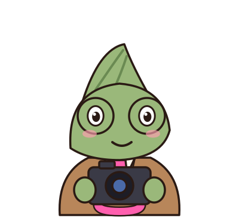 看看它

<p align="center"><a href="https://pma.rewrite.tw/?lang=zh">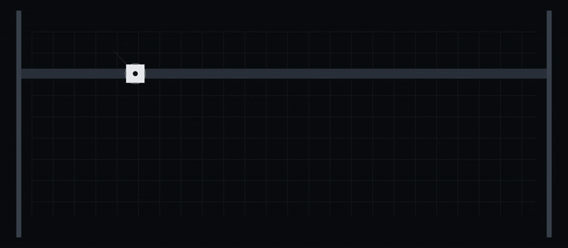</a></p>

<p align="center">GIF 沒有聲音。想聽聲音：<a href="https://pma.rewrite.tw/?lang=zh">線上示範</a> · <a href="docs/media/demo.mp4">12 秒有聲片段（MP4）</a>。</p>

## 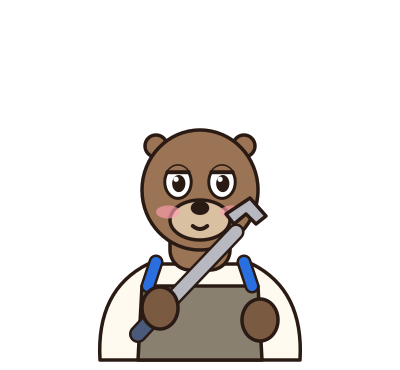 安裝

還沒有發布到 npm，請直接從 GitHub 安裝（安裝時會自動建置）：

```bash
npm install github:TENMALOG/procedural-machine-audio
```

##  快速開始

```ts
import { MachineAudio } from 'procedural-machine-audio';

const audio = new MachineAudio();

// 1. 聲音只能在使用者操作之後開始
startButton.onclick = () => audio.start();

// 2. 把模擬的事件對應到內建（或自訂）的配方
audio.bind('PART_PLACED', { recipe: 'click', gain: 0.9 });
audio.bind('VACUUM_ON', 'hiss');

simulation.on('PART_PLACED', (e) => audio.emit('PART_PLACED', { pan: e.x }));

// 3. 每一幀驅動移動部件的氣流聲
function frame() {
  const speed01 = head.speed / head.maxSpeed; // 0 = 靜止，1 = 全速
  if (audio.ready) audio.airflow('head').update(speed01, 1);
  requestAnimationFrame(frame);
}
```

##  API

### `new MachineAudio(options?)`

| 選項 | 預設 |  |
|---|---|---|
| `context` | — | 使用現有的 <code>AudioContext</code>／<code>OfflineAudioContext</code>；沒有的話由 <code>start()</code> 建立。 |
| `latency` | `0.03` | 每次觸發都加上的秒數，讓從畫面更新迴圈排程的聲音不會遲到。 |
| `maxVoices` | `48` | 同時發聲的一次性聲音上限。 |
| `reverb` | `0.12` | 空間感，0–1。 |

| 方法 | |
|---|---|
| <code>start()</code> | 建立／恢復 audio context。請在點擊或觸控的處理函式裡呼叫；也會讓 iPhone 開著靜音開關時仍有聲音。 |
| <code>play(name, { when?, delay?, gain?, pan?, key?, category? })</code> | 播放一個配方。被略過時回傳 <code>false</code>（不認得、音量為零，或和幾毫秒前相同的觸發合併）。 |
| <code>bind(event, recipe &#124; { recipe, gain?, category? })</code>／<code>emit(event, options?)</code> | 把模擬事件對應到配方。 |
| <code>define(name, recipe)</code> | 加入自己的配方。 |
| <code>airflow(id, { style?, pan? })</code> | 取得或建立具名的氣流聲部。每一幀呼叫 <code>.update(speed01, level)</code>；<code>.setStyle()</code> 換音色、<code>.silence()</code> 停止。 |
| <code>setLevel('master' &#124; 'events' &#124; 'airflow', value)</code>、<code>setReverb(amount)</code> | 混音。 |
| <code>output</code> | 最後一個節點（限幅器之後），可接分析器或 <code>MediaRecorder</code>。 |
| <code>suspend()</code>／<code>resume()</code>／<code>stopAll()</code>／<code>dispose()</code> | 生命週期。 |

### 內建配方

`click` · `tap` · `lift` · `hiss` · `leak` · `puff` · `feed` · `clamp` · `unclamp` · `shutter` · `swap` · `settle`

### 氣流音色

<code>smooth</code>（預設）· <code>warm</code>（較暗、較柔）· <code>airy</code>（較輕）· <code>slow</code>（緩慢起伏）

##  自訂配方

配方就是一般的資料：一串「層」。每一層是帶通雜訊或短音，各自有包絡。

```ts
audio.define('latch', [
  { kind: 'noise', noise: 'pink', freq: 1400, q: 0.8, lowpass: 3500, gain: 0.5, attack: 0.004, decay: 0.04 },
  { kind: 'noise', noise: 'brown', freq: 220, q: 0.7, lowpass: 600, gain: 0.25, attack: 0.008, decay: 0.12, delay: 0.03 },
]);
audio.play('latch');
```

讓聲音長時間聽起來舒服的小訣竅：<code>q</code> 保持低（約 0.6–1.5）、加上 <code>lowpass</code>、雜訊層至少給幾毫秒的 <code>attack</code>、避免很長的音調層。

## 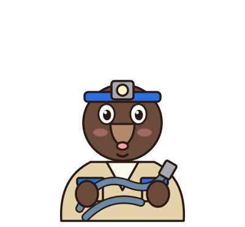 底層元件

引擎用到的每個元件都有匯出，可以自己組聲音流程：

| 匯出 | |
|---|---|
| <code>renderRecipe(ctx, destination, noise, recipe, { when, gain })</code> | 把配方排程到任意節點。 |
| <code>AirflowVoice</code>、<code>getAirflowBuffers</code>、<code>AIRFLOW_STYLES</code> | 氣流合成器，以及用 FFT 塑形的循環緩衝。 |
| <code>createNoiseBank(ctx, seconds, seed)</code> | 可指定種子、無接縫循環的白／粉紅／棕色雜訊。 |
| <code>createRoomImpulse(ctx)</code> | 給 <code>ConvolverNode</code> 用的短而柔和的空間脈衝響應。 |
| <code>VoicePool</code> | 聲部上限、搶占最舊的聲部、合併連發事件。 |
| <code>EventScheduler</code> | 給模擬用的確定性事件佇列（依時間、再依加入順序）。 |
| <code>planMove</code>、<code>sampleMove</code> | 梯形／S 曲線運動曲線，讓氣流聲跟著合理的速度。 |

##  氣流聲的原理

兩層循環雜訊用反 FFT 一次建好，所以循環沒有接縫：

- <b>主體</b>：具寬廣頻譜曲線的雜訊；音量跟著速度的平方，底下有一層很小的常駐氣流，整個頻譜也會隨速度往上移。
- <b>推力</b>：一段高斯形的低頻雜訊帶（不是共振），中心頻率隨速度升高。它的包絡比主體快，所以每次移動一開始都有一下輕柔的「推」。

高頻擱架比主體晚一點打開（「空氣感」），聲像在左右之間輕微飄動。沒有振盪器、也沒有共振濾波器，所以不會出現嗡聲或哨音。

##  開發

```bash
npm install
npm run dev        # 在 http://localhost:5320 開啟示範
npm test           # 單元測試
npm run build      # 函式庫 → dist/
npm run build:demo # 靜態示範 → dist-demo/
```

需要 Node.js 20 以上。

## 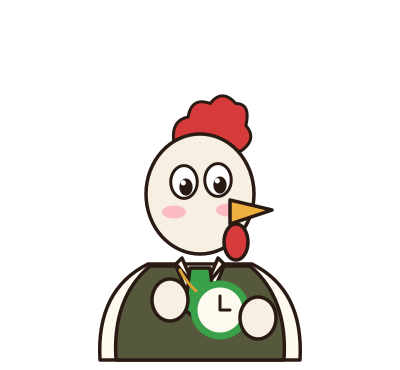 狀態

<code>0.1.0</code>：早期版本，API 之後可能還會變動。

## 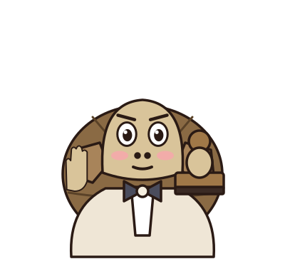 授權

程式碼：[MIT](LICENSE) © 2026 TENMALOG。

<code>docs/cast/</code> 裡的角色插圖是 TENMALOG 創作的假想社原創角色，<b>不在</b> MIT 授權範圍內，保留所有權利（[說明](docs/cast/NOTICE.md)）。QM-4 網站本身、它的 3D 模型、美術與調校過的聲音是另外的作品，也不在授權範圍內。

---

<div align="center">

### 假想社的成員


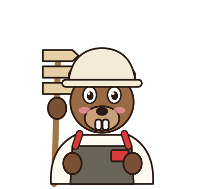
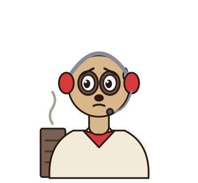
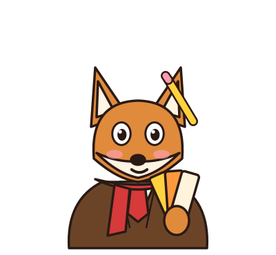

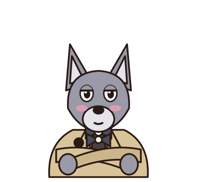


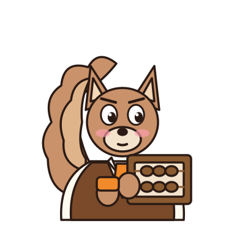


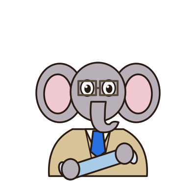


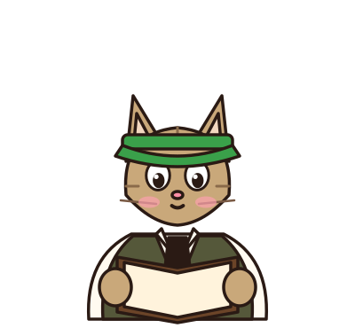


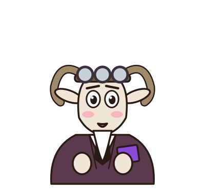
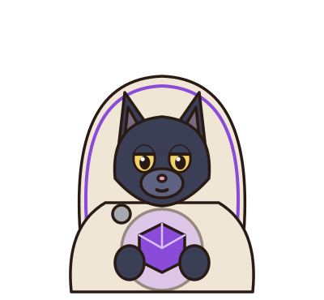
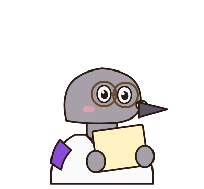

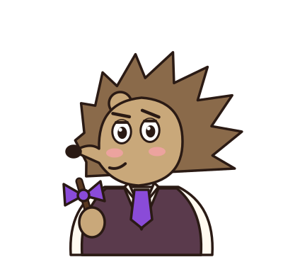
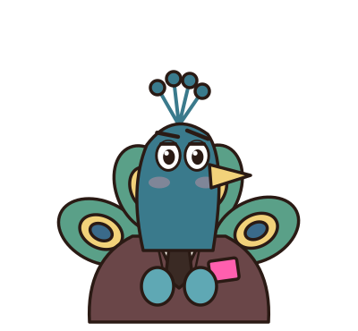
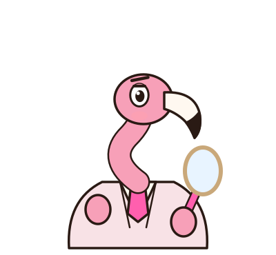


<sub>TENMALOG 的原創角色，陪你讀完這份說明。</sub>

<br><br>

製作：<b>TENMALOG</b> · <a href="https://qm4.rewrite.tw/?lang=zh">QM-4</a> · <a href="https://pma.rewrite.tw/?lang=zh">線上示範</a>

</div>
